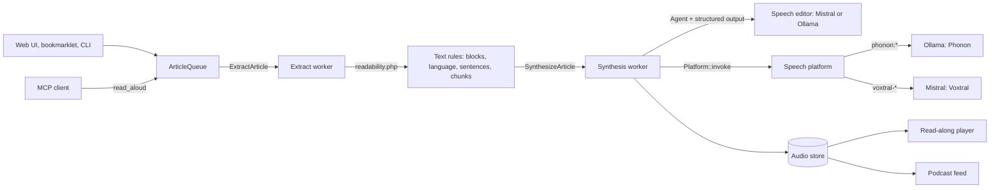

# Crieur

**Your reading list, read aloud.** Paste a link, or let your AI assistant send one over MCP: Crieur extracts the article, rewrites it for the ear with a language model, and reads it with a natural voice, in French or in English. The first words play within seconds, while the rest is synthesized. Follow along with the highlighted transcript, or subscribe to your library as a private podcast.

Crieur (French for *town crier*) started as a macOS menu bar app. This is its web version, rebuilt on **Symfony 8.1 and Symfony AI 1.0**, for the [Symfony AI & MCP Hackathon](https://symfony.com/hackathon). It runs **entirely on your machine** with [Ollama](https://ollama.com) (Phonon voices by Gradium, Ministral as speech editor), or in the cloud with a single [Mistral AI](https://mistral.ai) key (Voxtral voices, Mistral Small as speech editor).

> Demo video (90 s): _link to come_

Tags: **MCP** (server), **Text-to-speech**, **Structured output**, **Local AI**.

## What it does

- **Paste a link, listen in seconds.** The title is synthesized first and plays while the worker goes on, chunk after chunk, ahead of the voice.
- **Written for the ear.** A Symfony AI agent rewrites each batch of sentences for a voice: dates, decimals, units, version numbers, abbreviations, symbols, page leftovers. Its structured answer is checked for faithfulness: a chunk that comes back summarized or padded keeps the deterministic rules. *Show what the voice reads* reveals every rewrite.
- **Read-along player.** The sentence being read is highlighted. Speed from 0.75x to 2x without pitch change, female or male voice, French or English, previous and next paragraph, media keys, keyboard shortcuts, position remembered per article.
- **Your AI assistant can hand you articles.** The MCP server exposes `read_aloud`, `list_library` and `get_article`: ask Claude to find three good articles on a topic and send them to Crieur, then listen on your way home.
- **A private podcast.** Every finished article becomes an episode of a private RSS feed (AAC with ffmpeg, WAV otherwise) for any podcast app on your network.
- **Bookmarklet and CLI.** One click from any page, or `php bin/console crieur:read <url> --wait`.

## How Symfony AI is used

| Piece | Symfony AI / MCP feature |
|---|---|
| Speech platform (`crieur.platform.speech`) | One `Platform` with two text-to-speech providers, routed by model name (`CatalogBasedModelRouter`): `phonon:*` goes to Ollama, `voxtral-*` to Mistral AI. |
| Phonon through Ollama, Voxtral through Mistral | Two **new platform bridges** (`src/AI/Platform`): `ModelClient`, `ResultConverter`, `ModelCatalog` and provider factory each. Neither speech API is covered by the official Ollama and Mistral bridges yet. |
| Speech editor (`src/Editor`) | Two agents configured in `config/packages/ai.yaml` (Mistral or Ollama), a system prompt file, **structured output** (`response_format` mapped to the `SpokenBatch` class), selected at runtime from a service locator. |
| MCP server (`src/Mcp`) | `symfony/mcp-bundle` with `#[McpTool]` attributes and `#[Schema]` on parameters, over HTTP (`/mcp`) and STDIO (`bin/console mcp:server`). |
| Tests | `MockPlatformFactory` for the speech platform and the agents: the test suite never needs a model and never makes a sound. |

What it unlocked: one Symfony app now talks to a local speech model, a cloud speech model and two language models through the same abstraction, and any MCP client becomes a remote control for your ears.

## Quick start (5 minutes)

Requirements: PHP 8.4 or later (with `intl`, `pdo_sqlite`), [Composer](https://getcomposer.org), the [Symfony CLI](https://symfony.com/download), and **one** of:

- **Local stack (no key, Apple Silicon Mac):** [Ollama](https://ollama.com) 0.40.11 or later.
- **Cloud stack (any OS):** a Mistral AI API key.

```sh
git clone <this repository> crieur && cd crieur
composer install
php bin/console doctrine:migrations:migrate --no-interaction
```

Local stack:

```sh
ollama pull phonon:40m-multilingual   # the voices (150 MB)
ollama pull ministral-3:8b            # optional: the local speech editor (6 GB)
echo 'CRIEUR_EDITOR=ollama' >> .env.local   # only if you pulled ministral-3:8b
```

Cloud stack:

```sh
echo 'MISTRAL_API_KEY=your-key' >> .env.local
echo 'CRIEUR_VOICE_ENGINE=voxtral' >> .env.local
```

Then check and start:

```sh
php bin/console crieur:doctor --live   # says what is missing and how to fix it
symfony serve                           # also starts the two queue workers
```

Open <http://127.0.0.1:8000> and paste a link.

## Connect your AI assistant (MCP)

Claude Code, over HTTP while `symfony serve` runs:

```sh
claude mcp add --transport http crieur http://127.0.0.1:8000/mcp
```

Claude Desktop, over STDIO (`claude_desktop_config.json`):

```json
{
  "mcpServers": {
    "crieur": {
      "command": "php",
      "args": ["/absolute/path/to/crieur/bin/console", "mcp:server"]
    }
  }
}
```

Then ask: *"Find the announcement of Symfony AI 1.0 beta and send it to Crieur."* The article appears in the library, tagged MCP, and plays within seconds. The queue workers must run (`symfony serve`) for the article to be synthesized.

## Configuration

All settings are environment variables (`.env`, override in `.env.local`):

| Variable | Default | Meaning |
|---|---|---|
| `CRIEUR_VOICE_ENGINE` | `phonon` | `phonon` (local, Ollama) or `voxtral` (Mistral AI). Voices per language and gender live in `config/packages/crieur.yaml`. |
| `CRIEUR_EDITOR` | `auto` | Speech editor: `mistral`, `ollama`, `off`, or `auto` (Mistral when a key is set, else the deterministic rules). |
| `OLLAMA_HOST_URL` | `http://127.0.0.1:11434` | Where Ollama listens. |
| `MISTRAL_API_KEY` | empty | Needed for Voxtral and the Mistral speech editor only. |
| `CRIEUR_AUDIO_DIR` | `var/audio` | Where the synthesized chunks and episodes are stored (content-addressed: a sentence read by a voice is synthesized once). |
| `CRIEUR_ALLOW_PRIVATE_NETWORKS` | `0` | Pages on private networks (localhost, 10.0.0.0/8...) are refused unless set to `1`: a URL can come from an AI assistant. |

## Architecture



- `src/Extraction`: HTTP fetch (Symfony HttpClient, private networks refused by default) and [readability.php](https://github.com/fivefilters/readability.php).
- `src/Text`: deterministic preparation ported from the macOS app: blocks, French and English detection, ICU sentence breaking, number normalization, chunking (120 characters for the first chunk, then 300 in French and 400 in English).
- `src/Editor`: the speech editor and its faithfulness check.
- `src/Speech`: voices, synthesis, audio post-processing (silence trimming, level normalization to -24 dBFS), content-addressed audio cache.
- `src/MessageHandler`: the two Messenger workers (`extract` and `synthesize` queues, Doctrine transport on SQLite).
- `src/Mcp`: the MCP tools.

## Development

```sh
php bin/phpunit                    # the whole suite, no model needed
vendor/bin/phpstan analyse         # level 8
php bin/console crieur:voices:sample var/samples   # the same sentences read by every voice, to compare by ear
```

## Limits

- **Personal use.** There is no login: run it on your machine or behind your own authentication. The podcast feed address carries a secret derived from `APP_SECRET`.
- **Licenses of the voices.** The Phonon 40m models are CC BY-NC 4.0: personal and non-commercial use only. Voxtral follows the terms of Mistral AI.
- **Phonon through Ollama** needs an Apple Silicon Mac today; elsewhere use the cloud stack.
- **What the voice cannot show:** images, charts, code blocks and tables are skipped.

## Credits

Built by Mathieu Santostefano for the Symfony AI & MCP Hackathon 2026, with [Symfony AI](https://github.com/symfony/ai), the [PHP MCP SDK](https://github.com/modelcontextprotocol/php-sdk), [readability.php](https://github.com/fivefilters/readability.php), [Phonon](https://gradium.ai/phonon) by Gradium, and Voxtral and Ministral by Mistral AI.

## License

MIT, see [LICENSE](LICENSE).
