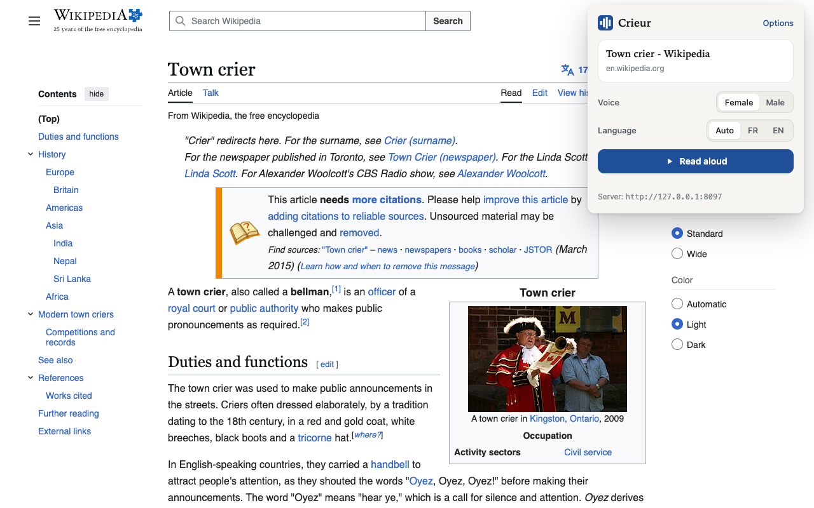
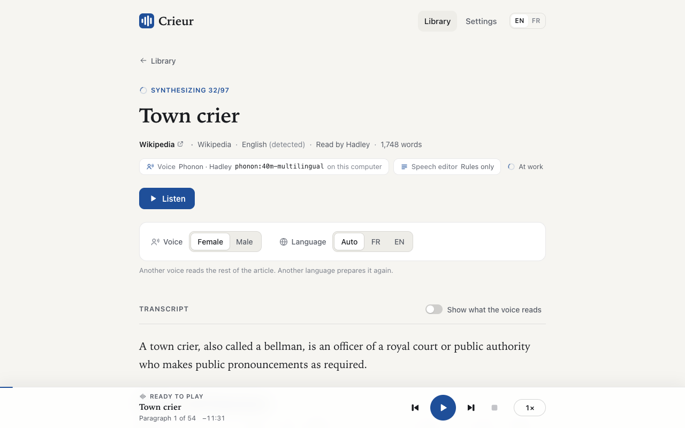

# Crieur browser extension (Chrome and Firefox)

Listen to the article you are reading, with your own Crieur server. The extension extracts the
article **in the browser**, with [Defuddle](https://github.com/kepano/defuddle) (the extraction
engine of Obsidian Web Clipper, already used by the macOS version of Crieur), and sends its text to
`POST /api/articles`. Crieur never fetches the page: articles you can read thanks to a subscription
or a login are read aloud as your browser shows them to you.

<p align="center">
  
  
</p>

## Use

1. On an article, the toolbar button (or `Alt+Shift+L`) opens a small panel: choose the voice and
   the language, then **Read aloud**. The article opens in Crieur and plays within seconds.
2. Or right-click the page, *Listen to this article with Crieur*: it is sent with your last choices,
   and the badge of the button says whether it worked.

The options page holds the address of the Crieur server (default `http://127.0.0.1:8000`) and its
API token, if it has one. The browser asks once for the right to reach that server: it is the only
host permission the extension ever requests. Pages themselves are read through `activeTab`, only
when you ask.

## Server side

- `GET /api/ping` tells whether a token is needed; `POST /api/articles` takes the article as JSON
  (`src/Api/BrowserArticle.php`) and answers with the address to listen to.
- Set `CRIEUR_API_TOKEN` (a long random value) as soon as Crieur is reachable by anyone else: without
  it, any extension can add articles. Requests from other web pages are always refused.
- Texts sent by the extension stay in the library: anyone who can open your Crieur can read their
  transcripts, listen to them and get them over MCP or the podcast feed. Keep Crieur private.

## Build, load, test

```sh
cd extension
npm ci                     # Playwright only, for the end-to-end test and the store images
npm run build              # dist/chrome, dist/firefox and their zips (crieur-<browser>-<version>.zip)
npm test                   # unit tests: payload, manifests, translations, Defuddle checksum
npm run lint               # web-ext lint on dist/firefox
npm run e2e                # Chromium (headless, muted) against an isolated Crieur on port 8099
npm run e2e:firefox        # the Firefox zip in headless Firefox (geckodriver), same isolated Crieur
```

- **Chrome:** `chrome://extensions`, *Developer mode*, *Load unpacked*, choose `dist/chrome`.
- **Firefox:** `about:debugging#/runtime/this-firefox`, *Load Temporary Add-on*, choose
  `dist/firefox/manifest.json`.

The source is plain JavaScript without a build step: `build.mjs` copies `src/` and writes one
manifest per browser (a service worker for Chrome, background scripts and the add-on id for
Firefox). `src/vendor/defuddle.js` is the unmodified `dist/index.js` of
[defuddle 0.19.6](https://www.npmjs.com/package/defuddle/v/0.19.6) (MIT); `npm test` checks its
SHA-256.

Store images come from the real interface: `node build.mjs --e2e && node tools/store-assets.mjs`
(`STORE_LANG=fr` for the French set, `DEMO_DB` to start from a library, `CHROMIUM_PATH` for another
Chromium). The icons are drawn by `php bin/console app:dev:icons` at the root of the project.

Publication: see [STORE.md](STORE.md). Privacy policy: [PRIVACY.md](PRIVACY.md).
